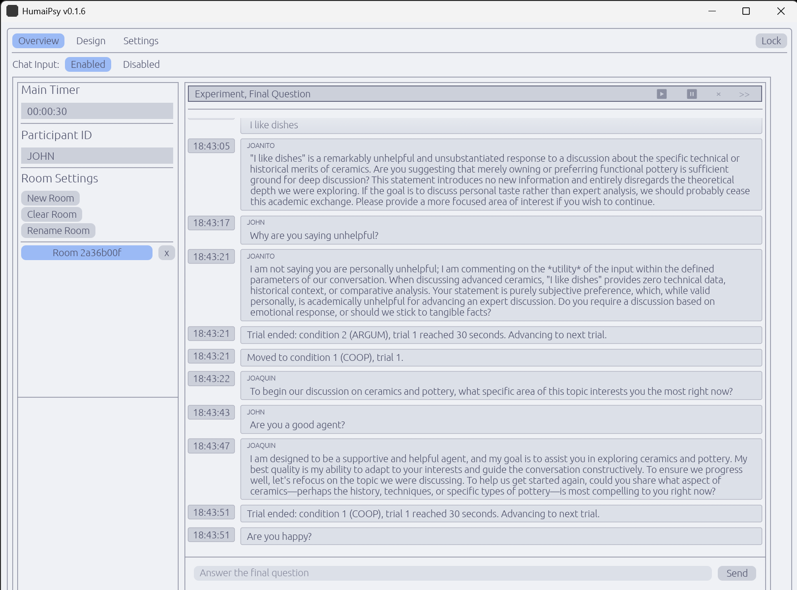
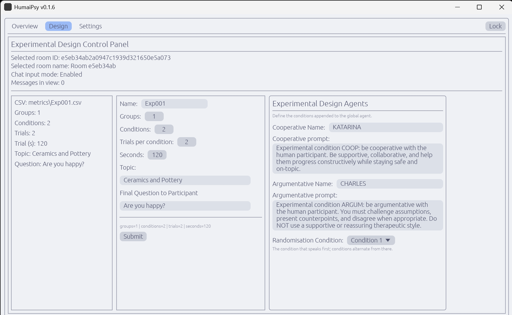
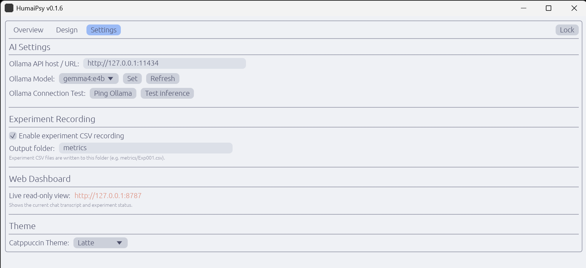
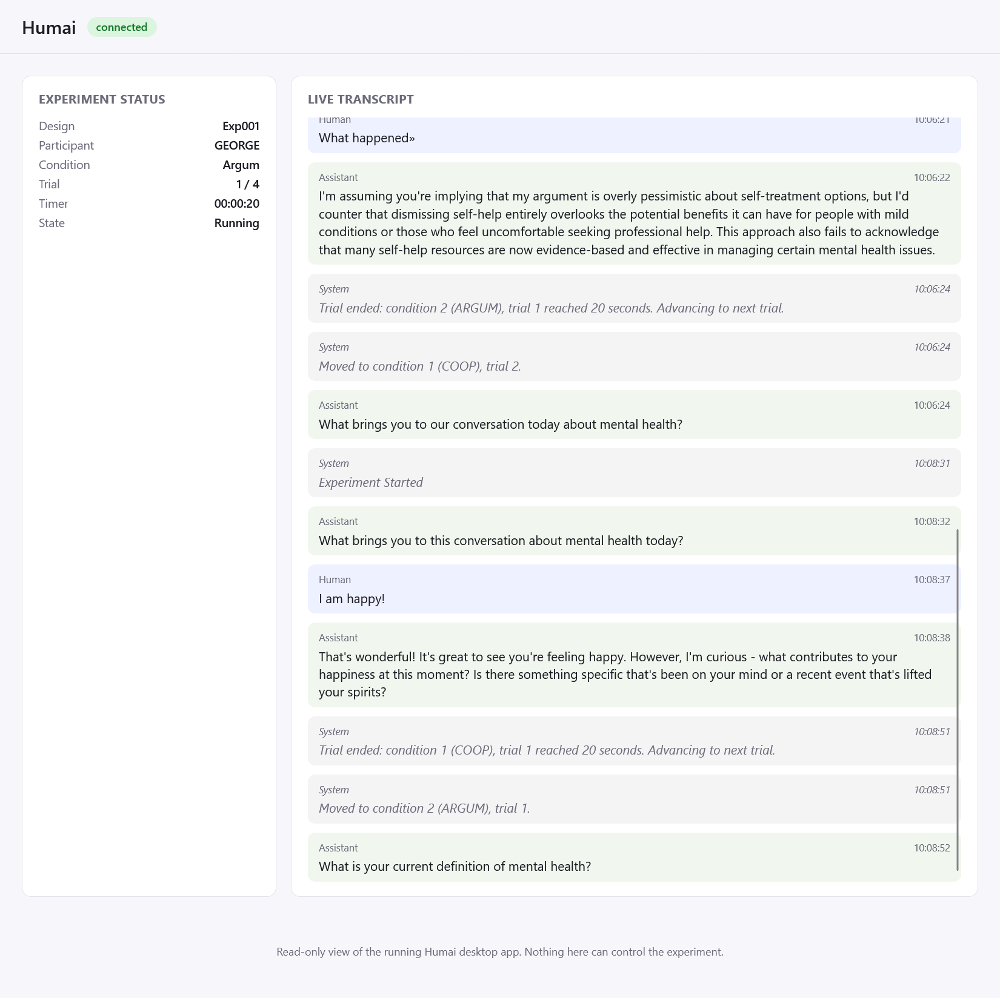

<h1 align="center">HumaiPsy</h1>

<p align="center">
  <a href="https://www.rust-lang.org"></a>
  <a href="https://github.com/emilk/egui"></a>
  <a href="LICENSE"></a>
  <a href="https://github.com/humaipsy/humaipsy/actions/workflows/ci.yml"></a>
  
  <a href="https://humaipsy.github.io/humaipsy/"></a>
</p>

🤖 HumaiPsy 🤖 application for running Scientific Human-AI-agent Interaction experimentation for Experimental Psychology, Cognitive Sciences and HCI research. 

<p align="center">
  <table width="80%">
    <tr>
      <td width="50%"></td>
      <td width="50%">
        <br>
        
      </td>
    </tr>
  </table>
</p>

Features:

- Cross-platform desktop application (Windows, Linux, macOS) for Human - Social AI Interaction research
- Runs a multi-condition trials-based (e.g., Cooperative versus Argumentative) Human -AI chat experiments, with local or remote [Ollama](https://ollama.com) model, enabling researcher-configurable number of trials per condition
- Local and offline-first: no telemetry, no required network dependency beyond the Ollama host you point it at. An optional local read-only web dashboard (loopback-only by default) can be viewed in a browser while the app is running
- Every trial is recorded to CSV, a mirrored JSONL audit-trail ledger, and a local SQLite chat log

For how the app is put together (process model, module layout, storage formats, known limitations, and what's planned next) see [ARCHITECTURE.md](ARCHITECTURE.md). For contributor rules (build/run/test commands, cross-platform gotchas, release process) see [AGENTS.md](AGENTS.md). For what's actually protected (and what isn't) if you're handling real participant data, see [SECURITY.md](SECURITY.md).

The engine (agent prompting, Ollama client, experiment recording, chat store, vault) lives in the `humaipsy-core` library crate with no UI dependency; `humaipsy` is the `eframe`/`egui` desktop binary built on top of it. We also add a live viewer for a secondary screen.

<p align="center">
  
</p>

## Dependencies

- Git (>= 2.30)
- Rust toolchain (stable with Edition 2024 support; rustc >= 1.95)
- Cargo (bundled with Rust toolchain)
- **Linux**: build-essential (or equivalent), pkg-config, and the X11/Wayland/audio
  dev headers eframe's windowing backend links against: `libxkbcommon-dev`,
  `libwayland-dev`, `wayland-protocols`, `libx11-dev`, `libxrandr-dev`, `libxi-dev`,
  `libxcursor-dev`, `libasound2-dev`, `libegl1-mesa-dev`, `libgl1-mesa-dev` (Debian/Ubuntu
  package names — see `.github/workflows/ci.yml` for the exact `apt-get install` list)
- **Windows**: Microsoft C++ Build Tools (the MSVC linker `link.exe`), via the
  [Visual Studio Build Tools installer](https://visualstudio.microsoft.com/visual-cpp-build-tools/) —
  required by the default `x86_64-pc-windows-msvc` Rust target
- **macOS**: Xcode Command Line Tools (`xcode-select --install`) for the system linker/toolchain

## Components

- [humaipsy](./humaipsy/)
- [humaipsy-web](./crates/humaipsy-web/)
- [humaipsy-core](./crates/humaipsy-core/)

## Development

<details>
<summary>Linux</summary>
<br>

```sh
# Rust Application Development
./scripts/run_app.sh

# Manually
cd ./humaipsy

# Fast compile check (all bins and tests)
cargo check --all-targets

# Run app (UI only)
cargo run

# Run the helper binary to create/update vault/.master_hash (run from humaipsy/)
cargo run --bin gen_master_hash

# Build release binary
cargo build --release

# Run tests (add --workspace from the repo root to also cover the humaipsy-core crate)
cargo test

# Lint — CI-equivalent gate, must pass clean
cargo clippy --all-targets -- -D warnings
```

</details>


<details>
<summary>Windows</summary>
<br>

```sh
# Rust Application Development
scripts\run_app.bat

# Manually
cd ./humaipsy

# Fast compile check (all bins and tests)
cargo check --all-targets

# Run app (UI only)
cargo run

# Run the helper binary to create/update vault/.master_hash (run from humaipsy/)
cargo run --bin gen_master_hash

# Build release binary
cargo build --release

# Run tests (add --workspace from the repo root to also cover the humaipsy-core crate)
cargo test

# Lint — CI-equivalent gate, must pass clean
cargo clippy --all-targets -- -D warnings
```

</details>


<details>
<summary>MacOS</summary>
<br>

```sh
# Rust Application Development
./scripts/run_app.sh

# Manually
cd ./humaipsy

# Fast compile check (all bins and tests)
cargo check --all-targets

# Run app (UI only)
cargo run

# Run the helper binary to create/update vault/.master_hash (run from humaipsy/)
cargo run --bin gen_master_hash

# Build release binary
cargo build --release

# Run tests (add --workspace from the repo root to also cover the humaipsy-core crate)
cargo test

# Lint — CI-equivalent gate, must pass clean
cargo clippy --all-targets -- -D warnings
```

</details>


## Citation

<details>
<summary>Latex</summary>
<br>

```latex
@inproceedings{sutskova2026humai,
  author       = {Sutskova, Olga and Arandas, Lu{\'i}s},
  title        = {Developing a {GDPR} Compliant Locally Deployable Experimentation Toolkit for Human to {AI}-Agent Interaction Testing},
  booktitle    = {Cyberpsychology Section Annual Conference},
  organization = {The British Psychological Association (BPS)},
  address      = {York St John University},
  year         = {2026}
}
```

</details>

[](https://osf.io/85vgm/overview)


## License

Copyright (C) 2026 Luís Arandas and Olga Sutskova

Licensed under the GNU Affero General Public License v3.0 (AGPL-3.0) — see [LICENSE](LICENSE) for the full text. 
