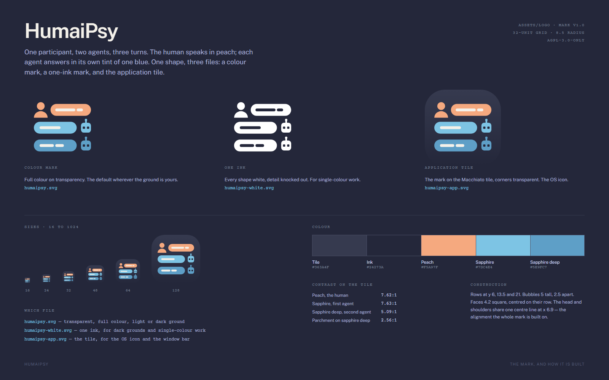

# The HumaiPsy mark

One participant, two agents, three turns. The human speaks in peach; each agent answers in
its own tint of one blue. The two blues are one colour at two values because Cooperative
and Argumentative are two conditions of one instrument, not two products.

This file is the quick guide. [`BRAND.md`](BRAND.md) is the design record —
construction, clear space, minimum sizes, contrast and usage rules. [`MANIFEST.toml`](MANIFEST.toml)
is the machine-readable one: every palette value and the SHA-256 of every file here.

## Geometry

The mark lives on a **32-unit grid**, view box `0 0 32 32`, and its own box is
`x 4–28, y 5.25–26`:

- three rows — bubbles 5 units tall, `rx 2.5`, at `y 6–11`, `13.5–18.5` and `21–26`, with
  a 2.5-unit gap between them;
- the human's head (circle, `r 1.65`) and shoulders (half-ellipse, 5.8 wide) share one
  centre line at `x 6.9` — the alignment the whole mark is built on;
- two agent faces, `4.2 × 4.2` with `rx 1.2`, each centred on its row, each with an
  antenna (a `0.7` stem and a `0.5` knob) and two eyes;
- detail bars 1.2 tall inside every bubble, set to the left of it, never centred.

Every row is centred on its own face, and every face is 4.2 inside a 5-unit row, which is
what puts 1.25 between an antenna's knob and the bubble above it. One pitch, three rows,
no exceptions.

## The peach and the two blues

| Token | Value | Use |
| --- | --- | --- |
| Peach | `#F5A97F` | The human: head, shoulders, bubble |
| Sapphire | `#7DC4E4` | The first agent: face, antenna, bubble |
| Sapphire deep | `#5E9FC7` | The second agent, in the same shapes |
| Parchment | `#F4F1EA` | The detail bars inside every bubble |
| Ink | `#24273A` | The eyes; the application tile's base |
| Tile | `#363A4F → #24273A` | The application tile, top to bottom |

Peach and the two navies are the Catppuccin Macchiato tokens `humaipsy/src/ui/theme.rs`
already paints with, so the icon and the window cannot drift apart. The mark and the
interface are the same colours by construction.

Peach on the tile is 7.62:1, sapphire 7.63:1, sapphire deep 5.09:1. The detail bars are
**not text** — they stand for a line of message, not for words — and their 1.71:1 is why
they read as a mark rather than as a caption. [`BRAND.md`](BRAND.md) has the full table,
including what happens in greyscale.

## Which file to use

| Family | For |
|---|---|
| `humaipsy.svg`, `humaipsy-<size>.png` | Transparent, full colour. Light or dark ground. |
| `humaipsy-white.svg`, `humaipsy-white-<size>.png` | One ink: white shapes, detail knocked out. Dark grounds, single-colour print, trays. |
| `humaipsy-app.svg`, `humaipsy-app-<size>.png` | The mark on the Macchiato tile. OS icons, window bar, store listings. |
| `humaipsy-app.rgba` | 64×64 unmultiplied RGBA for `egui::IconData`, embedded with `include_bytes!`. |
| `humaipsy-white.rgba` | The same 64×64 as a bare white mark, for a tray icon. |

## Sizes

16, 24, 32, 48, 64, 128, 256, 512 and 1024 pixels square, for all three families.

**Prefer the SVG** wherever the target accepts it. Each PNG was rendered at its exact size
from the SVG, not downscaled from a master — at 16 and 24 px that is the difference between
a crisp bar and a grey smear.

## Below about 32 pixels

The mark is specified from **32 px**; the tile from **16 px**. At 16 px the drawing stops
being legible and becomes a silhouette — one peach band over two blue ones — and that is
all any 16 px icon is. The tile is what gives the eye that silhouette to hold on to.

## The application icon

`humaipsy-app.rgba` is 64×64 unmultiplied RGBA, exactly the three fields `egui::IconData`
takes — 16,384 bytes, no decoder needed at run time. The tile is a 32-unit square with
`rx 8.5` (272 px at 1024) over a vertical `#363A4F → #24273A` gradient; the mark inside it
does not change scale between the tile and the bare mark.

The application tile is the Macchiato ink, not a colour: a bare peach mark sinks into a
light taskbar and a bare white one disappears on a light one, whereas an ink tile with a
full-colour mark reads on both.

## Regenerating

The SVGs are the source of truth; the PNGs and the `.rgba` are generated. `BRAND.md`'s
"Regenerating" section has the exact steps, and the short version is: render each SVG at
its exact pixel size on a transparent canvas (`chrome --headless --screenshot
--default-background-color=00000000`), write the 64 px tiles out as raw RGBA, then
regenerate `contact-sheet.png` and `MANIFEST.toml`.

## Licence

AGPL-3.0-only, like the rest of the repository — see [`../../LICENSE`](../../LICENSE).
The mark is original HumaiPsy work and contains no third-party asset.
